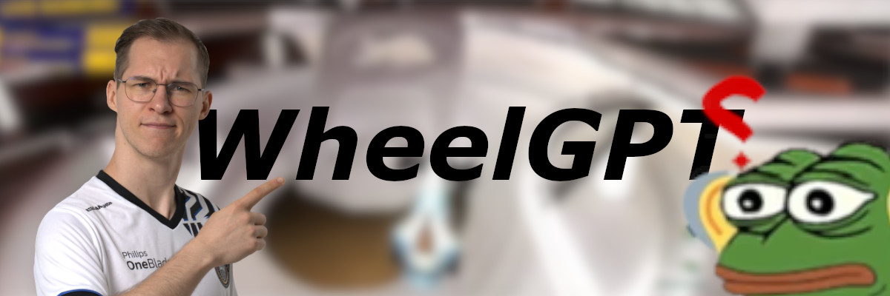
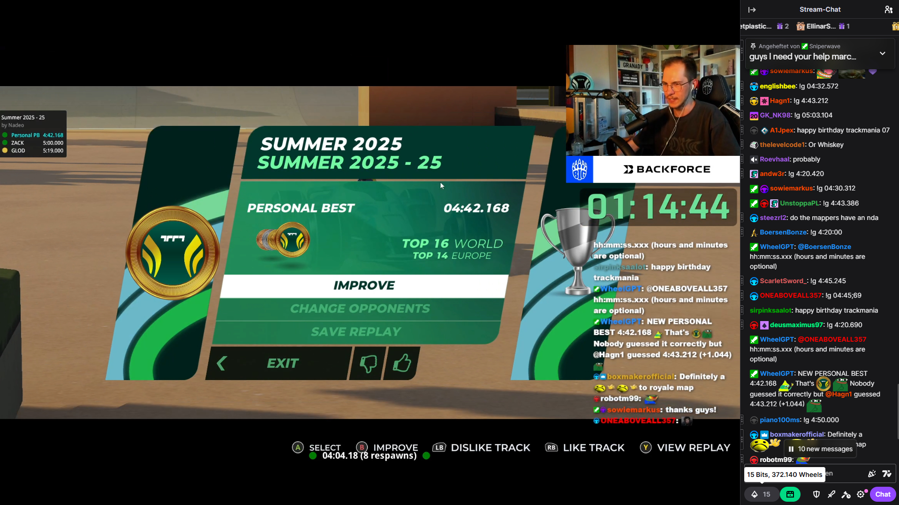

[](https://github.com/apps/in-solidarity)

More information on [wheelgpt.dev](https://wheelgpt.dev). Get the [OpenPlanet Plugin](https://openplanet.dev/plugin/wheelgpt-plugin).

WheelGPT is a [Trackmania](https://www.trackmania.com/) Twitch bot that lets viewers interact with the stream in real time. Viewers can use chat commands to check the current map, guess the streamer’s next personal best time, and get information about the current Trackmania room the streamer is playing in. All in-game data is collected and sent to the server by a dedicated Openplanet plugin, ensuring the bot always provides up-to-date information. Originally developed for GranaDyy – the wheel guy – WheelGPT now brings interactive Trackmania experiences to any Twitch channel.

The bot is a Go service that talks to Twitch through EventSub and the Helix API. The website at [wheelgpt.dev](https://wheelgpt.dev), built with React, is where streamers log in with Twitch, connect the bot, get their plugin token and change settings. Every channel also gets a public leaderboard with monthly rankings and a guess history per viewer.

## Any Questions? Feedback?

The HTTP API is documented with OpenAPI: browse it at [wheelgpt.dev/api/docs](https://wheelgpt.dev/api/docs/) or read [api/openapi/swagger.yaml](./api/openapi/swagger.yaml). Moving from the old TypeScript bot is described in the [switchover guide](./docs/switchover.md).
If you have any questions regarding the plugin or the Twitch Bot, feel free to contact me:

- Discord: sowiemarkus
- [markus.u.wieland@gmail.com](mailto:markus.u.wieland@gmail.com)

## Features

### Token

To use this plugin, you need a token. For that you need to register on [wheelgpt.dev](https://wheelgpt.dev). The token assigned to you is sent with every request to our server and identifies your Twitch channel. So don't share this token with anyone. Otherwise, others can use the plugin under your name and, for example, send best times to your Twitch channel that you have never driven.

The token assigned to you must be entered in the `Settings` -> `WheelGPT-Plugin` -> `Info/Token`.

### Personal Best

With the Twitch Bot, your viewers can guess what your next best time will be with `!guess <time>`. The format of the time is `hours:minutes:seconds.milliseconds`. `Hours` and `minutes` are optional. Example: `!guess 12.345` or `!guess 01:23.456`.

If the plugin is activated, whenever you set a new best time on a map, this time will be sent to our server. Afterwards all received guesses of your users will be checked and in the bot will announce in the chat which viewer was closest with the guess.

If you want to deactivate that your best times are sent to our server, you can deactivate this under `Settings` -> `WheelGPT-Plugin` -> ` Send PBs to Server`.

WheelGPT keeps a leaderboard of the best guessers in every channel at `https://wheelgpt.dev/c/{channel}`. It starts over every calendar month, and an all-time board keeps every point ever earned.

**Scoring System:**

- **Perfect Guess**: 5 points for guessing the exact time
- **Closest Guess**: 1 point for being the closest in a round

**Features:**

- **Monthly and all-time rankings** for every channel
- **Guess history**: every guess of a viewer with its result and points
- **Search** for a viewer's position

In chat, `!lb` shows this month's top 5, `!lb all` the all-time top 5 and `!lb <username>` a viewer's position in both.

The leaderboard encourages friendly competition among viewers and adds a persistent progression element to the guessing game, making each stream more engaging for regular participants. (And more YEK ofc)

### Map

With the Twitch bot, viewers can use the command `!map` to find out which map you are currently playing.
If the plugin is activated, whenever you enter a new map, this map is sent to our server. If you use the `Champion Medals` plugin, the Champion Medal time will also be sent to the server.

If you want to disable this feature, you can deactivate this under `Settings`->`WheelGPT-Plugin`->` Send Maps to Server`.

### Room

With the Twitch bot, viewers can use the command `!room` to get information about the current Trackmania room the streamer is playing in.  
If the plugin is activated, whenever you join a room, the room information (such as name, host, and player count) is sent to our server. This allows viewers to always see up-to-date room details via the bot.

If you want to disable this feature, you can deactivate it under `Settings` -> `WheelGPT-Plugin` -> `Send Rooms to Server`.

## Repository layout

The layout follows [bookmarks](https://github.com/SoWieMarkus/bookmarks).

| Path | What |
| --- | --- |
| `cmd/wheelgpt/` | Entry point of the backend |
| `internal/app/` | Composition root: config, router, wiring, background jobs |
| `internal/{auth,channel,plugin,ingame,guess,leaderboard,bot,eventsub}/` | Features, each with handler, service and repository |
| `internal/trackmania/` | Race times, medals and the chat texts |
| `internal/platform/` | Shared plumbing: `store` (SQLite, goose migrations, sqlc), `httpx`, `metrics`, `twitch`, `tmx` |
| `api/openapi/` | OpenAPI spec generated by swag from the handler annotations |
| `website/` | React + Vite website, served by nginx |
| `deploy/` | Dockerfiles of the backend and the website |
| `dev/` | Docker Compose stack for local development |
| `monitoring/` | Prometheus, alerts and the Grafana dashboard |
| `openplanet/` | Openplanet plugin |
| `docs/switchover.md` | Moving from the old TypeScript bot |

## Development

You need Go (see `go.mod`), Node 24 and Docker. `make help` lists everything.

```sh
cp .env.example .env
make up        # website :3000, API docs :3000/api/docs/index.html, Grafana :3001
```

The dev stack runs with `DEV_MODE=true`. Without Twitch credentials you log in at `/api/v1/auth/dev?login=you`, and chat replies are written to the log. The dashboard then has a **Dev mode** section with a "Go live" switch: the plugin's data is only accepted while the stream is live, so this lets you test the plugin (Openplanet setting *Test Local*) without streaming.

For hot reload run the pieces natively:

```sh
make backend   # API on :8080, metrics on :9091
make website   # Vite on :5173, proxies /api to :8080
```

After changing SQL or handler annotations run `make generate` (sqlc, swag, website API types). `make lint` and `make test` run what CI runs.

## Screenshots


